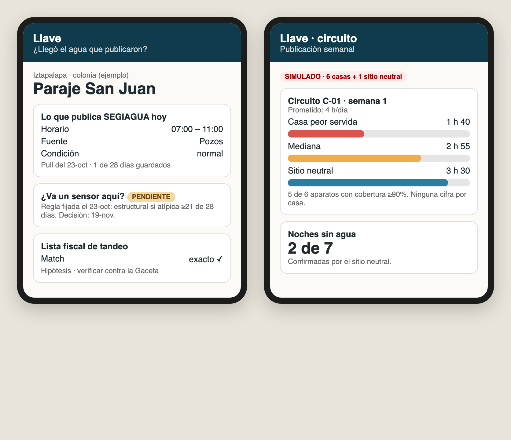
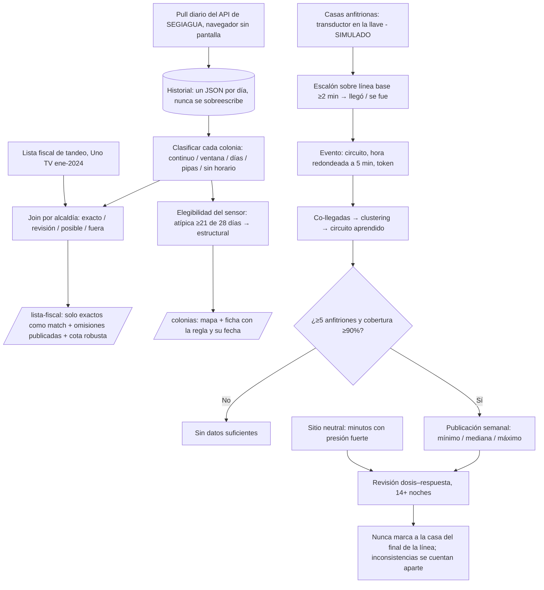
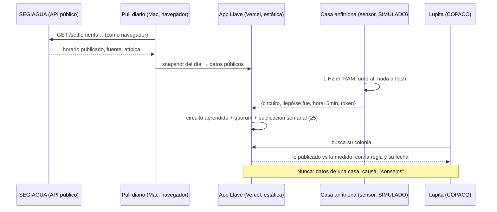

# Packet — w11-llave · "Llave: ¿llegó el agua que publicaron?"

> Written BEFORE the code (course discipline). Week 11 · Chapter 10 "Dreaming of Plenitude" · T4 · TECHNOLOGIST lens · Andrés Álvarez Morphy Namnum.
> Built from my brief's vacuum (Household water → delivery visibility at the tap) and the design rules the fight produced. The T4 Blueprint doesn't exist yet when I write this; the conditions table is re-checked against it when it does.

## The problem, in my words

Mexico City's reservoir is **full** (Cutzamala 92–94% in Oct-2026), and the network still loses **42% to leaks** (2022). The water crisis is in the pipe, not the sky. For a family under tandeo, the crisis is simpler. SEGIAGUA publishes a promise for every colonia (I pulled its open API: **2,006 colonias**, Iztapalapa **10 of 290 with continuous supply**). **Nobody records whether the promise is kept.** SEGIAGUA logs when a valve opens; nobody logs when the water reaches the tap.

The fight killed my first idea (a phone that wakes you up when water arrives). A ~MX$100 float on a drum captures the water without waking anyone, and NextDrop proved that alerts barely change welfare. What survived is the **ledger**: what was published, when water actually arrived, for how long, and which nights it never came.

## Exact user

- **"Lupita Hernández,"** 46, representative of her colonia's COPACO in Iztapalapa (east, daily window 07:00–11:00 on paper). She runs the neighbors' WhatsApp group, has filed requests at the alcaldía and with SEGIAGUA, and is told "su colonia tiene horario de 7 a 11". She knows that's not true but has no number. *(Invented persona, built from the week's research; not a real person.)*
- Her question: **"¿Cómo demuestro que el agua no llega como dicen?"**
- Second question: **"¿Por qué a la colonia de al lado le cobran como tandeo y a nosotros no?"**

## Definition of success

**Before the module closes**, at the live URL, no login, no personal data stored anywhere:
1. **`/colonias`**: real SEGIAGUA data for all 2,006 colonias on a map and a searchable list. For each colonia: what the city publishes (schedule, source, "atípica"), how many daily pulls I have, and its **sensor eligibility under a criterion fixed before the data** (≥21 of 28 days atypical = structural). Pending until 19-nov, shown as **PENDIENTE**.
2. **`/lista-fiscal`**: the join between SEGIAGUA's windows and the fiscal tandeo list (Uno TV transcription of the Gaceta, Jan-2024). Only exact matches are shown as matches. Per alcaldía it **shows how many are in manual review and not shown**. The robust bound: colonias with a daily window ≤8 h that no list name can cover, even with the most generous matching. Legal reading labeled "hipótesis — verificar contra la Gaceta".
3. **`/circuito`**: the ledger working on a **SIMULADO** circuit (labeled on every panel): 6 host houses + 1 neutral site with pressure feeds for 14 nights. In the browser:
   - (a) dumb detection (step over baseline, hysteresis ≥2 min);
   - (b) **ML that learns the valve circuit from co-arrivals** (agglomerative clustering);
   - (c) quorum of 2 only to wake others;
   - (d) the weekly publication: min / median / max minutes, ≥5 hosts, ≥90% coverage, otherwise "sin datos suficientes";
   - (e) the fraud check by **dose–response against the neutral's strong-pressure minutes**, which never flags the end-of-line house.
4. **`/sensor`**: phone-as-sensor. The microphone mode runs YAMNet **on the phone**; audio never leaves, and only "agua / sin agua" and "llegó / se fue" show on screen. Labeled **DEMO: probado solo en escritorio**. The pressure device spec shows exactly which 4 fields leave the device.
5. **`/metodo`**: every rule with the date it was fixed, what's MEDIDO vs SIMULADO, sources, and the kill criterion of the first field night.
6. A **daily pull** of the SEGIAGUA API starts the history (the API only answers real browsers, so the pull runs in a headless browser on my Mac). Each day is a new snapshot; old ones are never overwritten.

## Mockup (generated)

## Flow

**Swimlane: who does what**

## Benchmark

**The best existing solution on Earth for this is** NextDrop (India): it told households when intermittent water would arrive, using valvemen's reports. **Mine differs by** replacing the human reporter with physics at the tap. In Bangalore, 63% of valvemen's reports were wrong, and in CDMX the reporter would work for the institution being measured. The output is a public ledger by circuit, not an SMS to one phone.

## Long view (3 sentences)

If this slice works, Llave becomes the delivery ledger of the city. Every colonia with intermittent supply gets a public record of promised vs delivered water, kept by sensors that know nothing about the families that host them. The fiscal tandeo list and SEGIAGUA's repair priorities get argued with a measured number instead of a protest, and the same rails carry over to electricity in a blackout-prone grid.

## Scope cut (what I'm NOT building this week)

- No real sensor hardware (the field night is owed; kill criterion written). Devices on `/circuito` are SIMULADO and labeled.
- No accounts, no database of people, no device registry, no upload from the mic mode.
- No alarm product, no WhatsApp/SMS sending, no notifications.
- No fiscal claim generator. The join is evidence for a hypothesis; the legal reading is Money's.
- No GAM, Tlalpan or other alcaldías as focus (data shown for all; the demo walks Iztapalapa).

## Architecture + stack

| Piece | Choice | Why |
|---|---|---|
| App | Next.js 15 (App Router) on Vercel, mostly static | Free; no server state needed |
| Real data | `scripts/build_data.py` → `public/data/colonias.json` + `resumen.json` | SEGIAGUA pulls + fiscal list → static JSON |
| Daily pull | `scripts/pull_segiagua.cjs` (Playwright, headless Chromium) on my Mac via cron → `data/history/YYYY-MM-DD.json` → rebuild + deploy | The API resets non-browser clients |
| Map (geodata) | Leaflet 1.9 + OSM tiles, colonias as points | Free, no key |
| ML 1 | YAMNet (TF.js 4.22, model self-hosted in `/public/yamnet`), on device | Phone-as-sensor, nothing uploaded |
| ML 2 | Agglomerative clustering on co-arrival similarity, in browser (`lib/circuito.js`) | The non-commodity part: learning the circuit |
| Sensor feed | Simulated pressure (seeded RNG) with real tandeo windows | Labeled SIMULADO |
| Rules | `lib/reglas.js`, pure functions, unit-tested | Detection, quorum, publication, dose–response |

Security floor: no secrets needed (no API keys), no personal data, no forms that write anywhere. Search input validated (length ≤60, letters/numbers). CSP and security headers.

## Test plan

- **Unit (node --test):** detection (step + hysteresis), quorum, publication thresholds (≥5 hosts, ≥90% coverage → otherwise "sin datos"), dose–response (end-of-line never flagged on long-weak nights; naive cheater caught), clustering on a known circuit, join normalizer (1A SECCIÓN ≠ 2A SECCIÓN), schedule parser.
- **Data check:** the built JSON reproduces the fight's numbers (2,006; 597 continuo; Iztapalapa 10/290; robust bound 58).
- **E2E (Playwright vs prod):** every page loads; SIMULADO label present on `/circuito`; no per-house output anywhere; omissions count visible; mic page never sends audio (network interception: no request bodies with audio).
- **Persona test:** Lupita, screenshots in order, 3 tasks.
